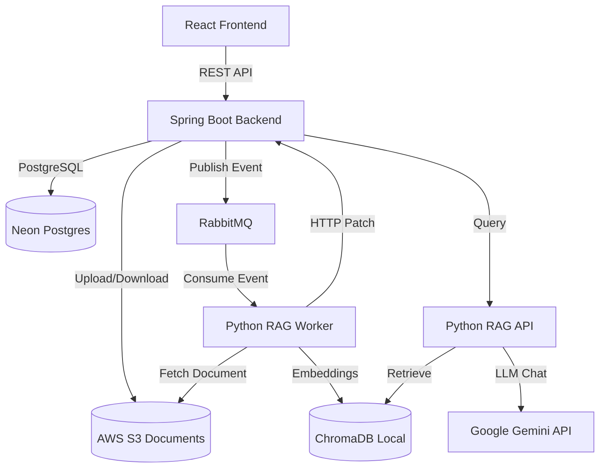

# DocAI Project Report

## SECTION 1: SYSTEM OVERVIEW

DocAI is a full-stack Retrieval-Augmented Generation (RAG) platform that allows users to upload documents, securely store them, and query their contents using an LLM-powered chat interface. It leverages a microservices architecture to separate the user-facing web API from the compute-intensive document processing and embedding logic.

### Architecture Diagram

### Current Deployment Status
- **Backend/RAG API/Worker:** *NEEDS MANUAL VERIFICATION* (Docker daemon not accessible locally; likely deployed to an EC2 instance).
- **Frontend Hosting:** *NEEDS MANUAL VERIFICATION* (S3 Static Website URL).
- **Database:** Neon Postgres (configured via `.env`).
- **File Storage:** AWS S3 (configured via `.env`).

---

## SECTION 2: BACKEND (docai-backend, Java/Spring Boot)

### 2.1 Entities
- **User:** `id`, `email`, `passwordHash`, `fullName`, `createdAt`.
- **Document:** `id`, `ownerId`, `owner` (ManyToOne), `fileName`, `storagePath`, `status` (PENDING, PROCESSING, INDEXED, FAILED), `uploadedAt`, `shares` (OneToMany).
- **DocumentShare:** `id`, `document` (ManyToOne), `sharedWith` (ManyToOne), `role` (VIEWER).
- **ChatMessage:** `id`, `documentId`, `userId`, `question`, `answer`, `createdAt`.

### 2.2 Controller Endpoints
- **AuthController:**
  - `POST /api/auth/register` (Public)
  - `POST /api/auth/login` (Public)
- **DocumentController:**
  - `POST /api/documents/upload` (Authenticated) - Multipart file upload.
  - `GET /api/documents` (Authenticated) - List user documents.
  - `PATCH /api/documents/{id}/status` (Public in SecurityConfig, but guarded by `X-Service-Token` header check matching `SERVICE_API_KEY`).
  - `DELETE /api/documents/{id}` (Authenticated) - Delete document.
  - `POST /api/documents/{id}/share` (Authenticated) - Share document (Default role: VIEWER).
- **ChatController:**
  - `POST /api/chat/ask` (Authenticated) - Ask a question.
  - `GET /api/chat/history/{documentId}` (Authenticated) - Get chat history.

### 2.3 Security
- **JWT Implementation:** Used for user authentication (Stateless session in SecurityConfig).
- **Password Hashing:** `BCryptPasswordEncoder`.
- **CORS Config:** Currently set to **WILDCARD** (`*` for allowed origins, methods, and headers).
- **Service-to-Service Auth:** `PATCH /api/documents/{id}/status` is explicitly allowed in `SecurityConfig` but manually checks the `X-Service-Token` header against `SERVICE_API_KEY`.

### 2.4 Exception Handling
- `GlobalExceptionHandler` covers:
  - `AccessDeniedException` -> `403 Forbidden`
  - `IllegalArgumentException` ("Invalid credentials") -> `401 Unauthorized`
  - `IllegalArgumentException` ("Email already registered") -> `400 Bad Request`
  - Other `IllegalArgumentException` -> `400 Bad Request`
- Anything else falls through to default Spring Boot `500 Internal Server Error`.

### 2.5 Known Bugs/Gaps
- **DocumentShare Serialization Crash:** `Document` contains a list of `DocumentShare`, and `DocumentShare` contains a `Document`. Missing `@JsonIgnore` / `@JsonManagedReference` will cause infinite recursion and a StackOverflowError upon JSON serialization.
- **Missing Revoke Share Endpoint:** No endpoint exists to remove a `DocumentShare`.

---

## SECTION 3: RAG SERVICE (docai-rag-service, Python/FastAPI)

### 3.1 Endpoints
- `GET /health`
- `POST /ingest`
- `DELETE /documents/{document_id}`
- `POST /query`

### 3.2 Ingestion Pipeline
- **Chunking:** `RecursiveCharacterTextSplitter` (chunk_size: 1000, chunk_overlap: 150).
- **Embedding Model:** `models/gemini-embedding-001`.
- **Vector Store:** ChromaDB, structured as one collection per document (`document_{document_id}`).
- **Idempotency:** `_clear_existing_collection` deletes any pre-existing Chroma collection for a document ID before re-ingesting.

### 3.3 Query Pipeline
- **Retrieval:** `k = 4` chunks retrieved from ChromaDB.
- **Prompt Structure:** Strict rules restricting markdown syntax, asking the LLM to refuse answering if not in context.
- **LLM Model:** `gemini-3.6-flash`.
- **Citations:** Returned as a list of `SourceChunk` (chunk_index and 200-character snippet).

### 3.4 Worker Behavior
- **RabbitMQ Consumer:** Listens to `document.processing.queue`.
- **Retry/Backoff:** Attempts connection 10 times with a 3-second delay.
- **Fallback:** If RabbitMQ is completely unavailable after retries, the worker simply terminates (logs "relying on HTTP fallback. Worker terminating").
- **Reporting:** Uses `httpx.patch` to update the Spring Boot backend with status `INDEXED` or `FAILED`.

### 3.5 Known Limitations
- No streaming responses.
- No page-number citations (only chunk index).
- Local-disk-only ChromaDB persistence (`persist_directory="./chroma_store"`).

---

## SECTION 4: FRONTEND (docai-frontend, React)

### 4.1 Routes (Actual State)
- `/` - Landing
- `/login` - Login
- `/register` - Register
- `/dashboard` - Dashboard (Protected)
- `/documents` - Documents (Protected)
- `/documents/:documentId` - DocumentViewer (Protected)
- `/chat/:documentId` - Chat (Protected)
- `/analytics` - Analytics (Protected - *UI Scaffolding only, no backend API*)
- `/settings` - Settings (Protected - *UI Scaffolding only*)

### 4.2 State Management
- React Context API (`AuthProvider`, `ToastProvider`). No Redux.

### 4.3 API & Design
- Uses Vite.
- Design System: Custom CSS (`styles.css` is quite large at ~17KB, suggesting a substantial custom styling approach or a bundled framework).
- *Visual state needs manual verification to confirm the exact shipped theme.*

---

## SECTION 5: INFRASTRUCTURE & DEPLOYMENT

### 5.1 Database
- **Neon Postgres:** *NEEDS MANUAL VERIFICATION* to confirm the current connection is live. (Configured via `NEON_ENDPOINT` in docker-compose).

### 5.2 File Storage
- **S3 Bucket:** *NEEDS MANUAL VERIFICATION* for bucket name, region, and exact permission state.

### 5.3 Compute
- **EC2:** *NEEDS MANUAL VERIFICATION* (Cannot verify instance type, region, memory headroom, or swap configuration from codebase).

### 5.4 Message Queue
- **RabbitMQ:** Dockerized via `rabbitmq:3.12-management-alpine`. *Health check needs manual verification.*

### 5.5 Frontend Hosting
- **S3 Static Website:** *NEEDS MANUAL VERIFICATION* for current URL.

### 5.6 Docker Compose
- Currently defined services: `rabbitmq`, `redis`, `docai-backend`, `docai-rag-api`, `docai-rag-worker`, `docai-frontend`.
- Local Postgres is notably absent (successfully removed in favor of Neon).

### 5.7 Cost Status
- *NEEDS MANUAL VERIFICATION* (Confirm AWS Free Tier status and expiry).

---

## SECTION 6: SECURITY POSTURE

### 6.1 Fixed Issues
- **IDOR Vulnerability:** ChatController now uses `findAccessibleByIdAndUserId` to ensure users can only query documents they own or have access to.
- **Auth Error Codes:** `GlobalExceptionHandler` properly maps auth exceptions to 401 and 400 instead of generic 500s.

### 6.2 Current Open Gaps
- **CORS:** Currently configured as a wildcard (`*`) allowing all origins.
- **Rate Limiting:** Absent. No rate limiters observed in backend or RAG service.
- **SSH Security Group State:** *NEEDS MANUAL VERIFICATION* (0.0.0.0/0 or restricted?).

### 6.3 Secrets Handling
- `.env` files are in `.gitignore`.
- `.env.example` is clean.
- No exposed secrets found in the current tree.

---

## SECTION 7: TESTING STATUS

### 7.1 Automated Testing
- **None.** There is NO automated test coverage (no JUnit/Mockito tests in the backend, no PyTest suites in the RAG service).
- Only manual python script fragments (`test.py`, `report_test.py`, `test_share.py`) exist in the root folder.

### 7.2 Manual Verification
- *NEEDS MANUAL VERIFICATION* (When was the full checklist last run clean?).

---

## SECTION 8: FEATURE STATUS MATRIX

| Feature | Status | Notes |
|---|---|---|
| Authentication | Working | Registration and JWT login functioning. |
| Upload & Storage | Working | Multipart upload and S3 integration functioning. |
| RAG Chat & Citations | Working | Basic QA works with chunk-index citations. No page numbers. |
| Document Isolation / IDOR | Working | Protected via repository queries. |
| Document Sharing / RBAC | **Broken** | API exists but triggers JSON serialization infinite recursion (StackOverflowError). |
| Rate Limiting | Not Started | Completely absent. |
| Streaming Chat | Not Started | Standard synchronous request/response only. |
| Analytics | Not Started | Frontend route exists, but no backend implementation. |
| Settings | Not Started | Frontend route exists, but no backend implementation. |
| Mobile Client | Not Started | Web only. |
| Multi-document Comparison | Not Started | Querying is strictly locked to a single `documentId`. |

---

## SECTION 9: RESUME/INTERVIEW-READY SUMMARY

### 9.1 Project Description
DocAI is a full-stack Retrieval-Augmented Generation (RAG) platform that enables users to securely upload and chat with their documents. Built using a microservices architecture, it pairs a Spring Boot REST API for user and document management with a Python FastAPI service for asynchronous document processing and LLM querying. The system leverages RabbitMQ for reliable background embedding generation and ChromaDB for vector retrieval.

### 9.2 Technical Talking Points
- **Microservices Event-Driven Architecture:** Decoupled the document ingestion pipeline into a separate Python worker using RabbitMQ, allowing the Spring Boot API to remain responsive during heavy embedding tasks.
- **Idempotent Vector Ingestion:** Implemented a pre-ingestion collection clearing strategy in ChromaDB to prevent vector duplication and ensure clean state during database resets or re-uploads.
- **Security & IDOR Remediation:** Identified and patched Insecure Direct Object Reference (IDOR) vulnerabilities in the chat endpoint by strictly enforcing repository-level ownership checks during queries.

### 9.3 What NOT to Claim
- Do not claim the system has robust automated testing (it has none).
- Do not claim Document Sharing works perfectly (it currently crashes due to Jackson serialization bugs).
- Do not claim streaming chat responses, multi-document comparison, analytics, or settings features are implemented.
- Do not claim the app uses advanced rate limiting or production-hardened CORS configurations.
